<p align="center">
  <picture>
    <source media="(prefers-color-scheme: dark)" srcset="docs/images/logo-dark.png">
    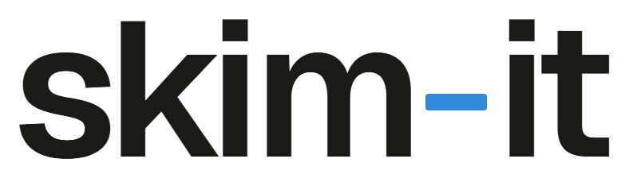
  </picture>
</p>

<p align="center">
  A calmer, more scannable Claude Code Desktop.
  <br>
  One line for every turn of work, answers you can skim, and a band that shows every session you run in parallel.
</p>

<p align="center">
  <a href="https://github.com/LunkiBR/skim-it/actions/workflows/checks.yml"></a>
  <a href="LICENSE"></a>
  <a href="#requirements"></a>
  <a href="README.pt-BR.md"></a>
</p>

<p align="center">
  <a href="https://lunkibr.github.io/skim-it/">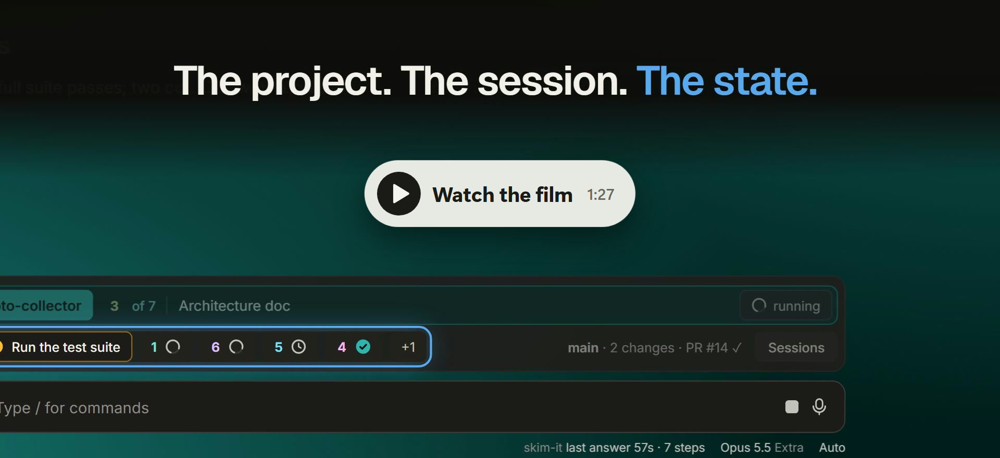</a>
  <br>
  <sub><a href="https://lunkibr.github.io/skim-it/">Watch the launch film</a> · 1:27 · sound on</sub>
</p>

## Why

Running five or ten Claude Code sessions at once is normal now.
The Desktop shows each one in isolation: to know which session is waiting for you, you open them one by one.
Long turns bury the answer under tool calls and narration.
skim-it is a mod that fixes both.

## Install

At the prompt of a Claude Code session:

```
/plugin install skim-it --marketplace LunkiBR/skim-it
```

Answer `y` to add the marketplace, then pick a scope.
From a shell:

```bash
claude plugin install skim-it --marketplace LunkiBR/skim-it
```

Open a new session and type `/skim-it` to see the settings.
Before a session's first message the mod is not running yet, so the list shows `/skim-it:ajustes` instead: it opens the same card.

### Requirements

- Claude Code 2.1.325 or newer, in the Code tab of Claude Desktop.
- `git` on the PATH for the Git line, and the [GitHub CLI](https://cli.github.com) signed in for PRs and CI (optional).
- Built and used daily on Windows; macOS and Linux should work but have not been tested yet.

If another theme mod (such as `/custom-theme`) is on for the same project, the two will trade the look on every message.
Turn the other one off for that project.

### Update, turn off, uninstall

```bash
claude plugin update skim-it
claude plugin disable skim-it
claude plugin uninstall skim-it
```

The sessions leave one small file each in `~/.claude/skim-it/fleet/`; delete `~/.claude/skim-it` after uninstalling to remove every trace.

## What changes

skim-it is not a status bar.
It changes how the whole Desktop reads, in seven places:

1. [All the work, in one line](#all-the-work-in-one-line)
2. [Answers you can skim](#answers-you-can-skim)
3. [A band above the prompt](#a-band-above-the-prompt)
4. [The session that needs you comes first](#the-session-that-needs-you-comes-first)
5. [Every session, by state](#every-session-by-state)
6. [Every project, its own color](#every-project-its-own-color)
7. [A background that follows the session](#a-background-that-follows-the-session)

And one card holds every setting: [`/skim-it`](#one-card-for-every-setting).

### All the work, in one line

<p align="center">
  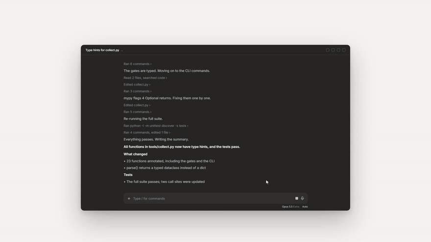
</p>

When a turn ends, one line sums up all its work (commands, file reads, narration, failures): `Worked 7m 57s · 54 steps · 3 files · 1 failure ›`.
A click opens every step, and a failure never disappears from the line.
In the Desktop the line sits right above the answer and the turn's rows stay as the app draws them: the Desktop keeps its tool groups and narration summaries out of a mod's reach. In a terminal the rows fold into the line, as shown here.
Three densities: compact (one line per turn, the default), balanced (one line per kind of work) and detailed (as the app draws it).

<details>
<summary>Before, and the line opened</summary>
<br>
<p align="center">
  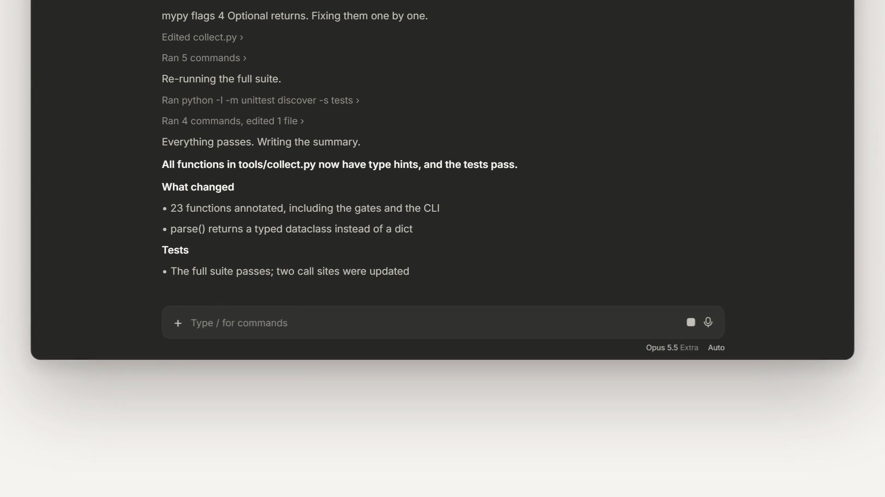
  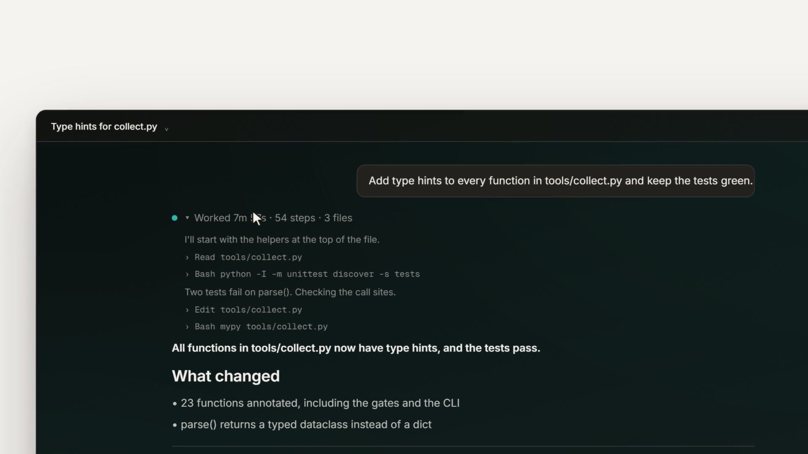
</p>
</details>

### Answers you can skim

<p align="center">
  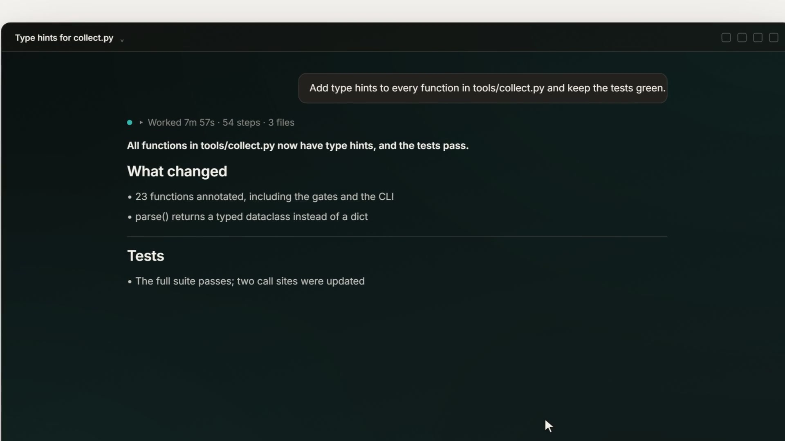
</p>

With typography on, the mod asks the model to write longer answers in sections: a one-sentence summary first, then a heading for each part.
Each heading is drawn one step larger, with a rule between sections; tables, code and lists are left as the app draws them, and a short answer stays as it is.

### A band above the prompt

<p align="center">
  <picture>
    <source media="(prefers-color-scheme: light)" srcset="docs/images/band-light.png">
    
  </picture>
</p>

- **Who am I.** The project in its own color, the session number ("3 of 10") and an automatic subject written by Haiku.
- **What I am doing.** One icon and one word: running, needs you, in the background, ready to review, no signal, idle.
- **The rest of the fleet.** Every other session of the project by number and state, the waiting ones first.
- **Git.** Branch, changes and PR with its CI. A click opens a panel with your open PRs, changed files and recent branches.

<details>
<summary>Four widths, and the states</summary>
<br>
<p align="center">
  The band fits four widths, from a wide window down to a single line in a split view.
  <br><br>
  
  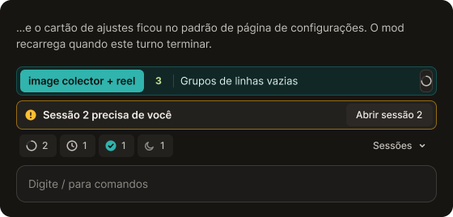
  <br><br>
  
</p>
</details>

### The session that needs you comes first

<p align="center">
  
</p>

When another session of the project is waiting for an approval or an answer, an amber line says which one and what it needs, with a button that opens it.
Amber is used for nothing else, so it always means you.

### Every session, by state

<p align="center">
  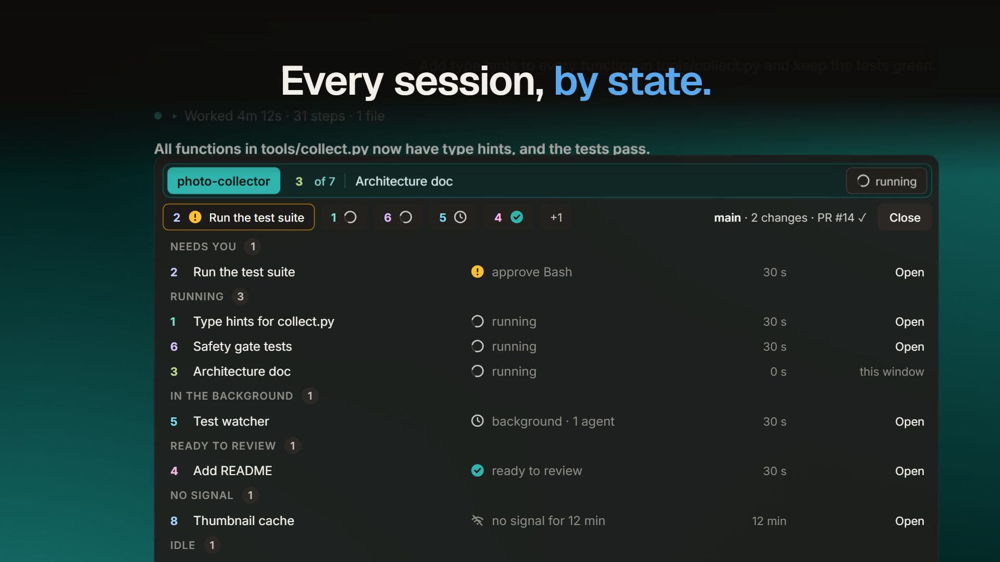
</p>

The sessions panel lists all sessions of the project grouped by state, with whoever is waiting on top, parent and child sessions, and a safe bulk archive for the ones idle for over 30 days.

### Every project, its own color

<p align="center">
  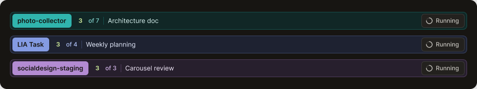
</p>

A calm, high-contrast look: tinted grays, primary text at 7:1 on every surface, color only where it means something.
Each project gets its own color, from your brand file or from a stable hash of the repository, and the look follows the session you typed in last.
Red, green and amber never stand for a project.

### A background that follows the session

<p align="center">
  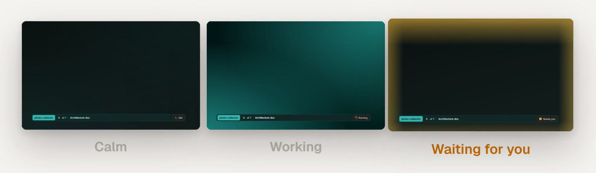
</p>

Behind the frosted glass, the background tells you the session's state at a glance: nearly gray at rest, the project's color breathing slowly while it works, and amber light along the edges while it waits for you.

### One card for every setting

<p align="center">
  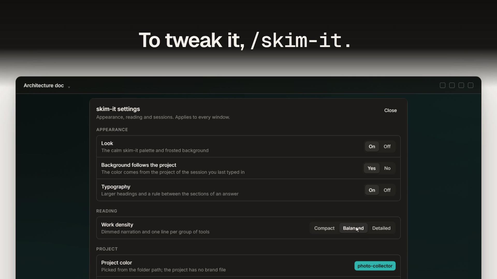
</p>

Type `/skim-it` and every setting is in one card; each one is also a [command](#commands).

> The film and these images redraw Claude Code Desktop from the mod's own design and code (band, colors and backgrounds), on a demo fleet of sessions like the one `/skim-it demo` shows.
> In the app the mod draws the same layout with the Desktop's own components, so radius and type follow your Desktop.

## Commands

Every setting is in the card that `/skim-it` opens, and each one is also a command.
Commands take English or Portuguese words (`density` or `densidade`).

| Command | What it does |
|---|---|
| `/skim-it` | Opens the settings card |
| `/skim-it:ajustes` | Opens the settings card too, and is listed even before a session's first message |
| `/skim-it typography on\|off` | Answers in sections, with larger headings and a rule between them |
| `/skim-it density compact\|balanced\|detailed` | How much of a turn's work stays visible |
| `/skim-it look on\|off` | The skim-it look on the Desktop |
| `/skim-it background follows on\|off` | The look follows the project of the session you typed in last |
| `/skim-it panel` | Opens or closes the sessions panel |
| `/skim-it import` | Proposes a brand file from the project's colors; `import approve` writes it |
| `/skim-it language auto\|pt\|en` | The mod's language; `auto` follows Claude Code |
| `/skim-it demo` | Shows a sample fleet of seven sessions, for screenshots and recordings |

## Brand file

Put `.claude/skim-it.json` at the root of a repository to give it a color:

```json
{
  "tipo": "projeto",
  "marca": { "primaria": "#4b63ce", "secundaria": "#7db2ff" },
  "areas": [{ "caminho": "web/", "intensidade": "vibrante" }]
}
```

| Key | Meaning |
|---|---|
| `tipo` | `projeto` (sessions toward one goal: band, panel, parent and child) or `espaço` (loose sessions that only share a folder: color and subject only) |
| `marca.primaria` | The project color; it becomes the accent and the hue of the look |
| `marca.secundaria`, `marca.neutra` | Optional extra brand colors |
| `areas` | Paths that change intensity (`vibrante` or `denso`), never the hue |

The keys are in Portuguese because the mod was born in Portuguese.
`/skim-it import` reads Tailwind config, CSS variables, `tokens.json`, `package.json`, `SKILL.md` and `README.md`, proposes the file with the evidence it found, and writes nothing until you approve.

## Privacy and what it runs

- **Session files.** Each session writes a small JSON file to `~/.claude/skim-it/fleet/` (project root, subject, state, timestamps) so the other sessions can see it. Nothing leaves your machine.
- **Prompt.** With typography on, in the Desktop, a short note goes with each of your prompts, read only by the model, asking for answers in sections. Turn typography off and it stops.
- **Subject.** The automatic subject is one short Haiku call per turn through Claude Code's own model access, with the start of your request and of the answer.
- **Desktop tools.** Session titles, parent sessions and the archive go through the Desktop's own session tools. In a terminal or over SSH those calls fail quietly and the band uses the session files alone.
- **Processes.** `git` (status, branch, diff stats, recent branches) and `gh` (PR list and checks), only in the session's folder. Opening another session hands a `claude://` or `https://` link to the system.
- **No network** of its own, no telemetry.

## How it works

skim-it is a Claude Code mod: a TypeScript hooks module the engine loads, with no DOM and no Node.
It draws through `ui.render` hooks, sets the look through `$.theme.set`, and keeps the turn's work from `turn.*` and `tool.call` events.
[docs/ARCHITECTURE.md](docs/ARCHITECTURE.md) maps the modules, [docs/DESIGN-SYSTEM.md](docs/DESIGN-SYSTEM.md) holds the tokens and the rules behind the colors and icons, and [docs/ENGINE-NOTES.md](docs/ENGINE-NOTES.md) lists what the engine refuses and what the Desktop actually draws.

## Development

```bash
git clone https://github.com/LunkiBR/skim-it
cd skim-it
claude --plugin-dir .
```

The checks are plain Node scripts for the pure logic (color engine, states, typography, Git parsing):

```bash
npm test
```

Before a pull request, also run `claude plugin test .`, `claude plugin validate .` and `npm run typecheck` (after the first load, which writes the types to `.claude-plugin/types/`).
[CONTRIBUTING.md](CONTRIBUTING.md) has the details.

## License

[MIT](LICENSE), except `hooks/make-colors.js` and `hooks/make-colors.d.ts`, which come from the Claude Code plugin authoring kit.

skim-it is an independent project and is not affiliated with or endorsed by Anthropic.
