<p align="center">
  <picture>
    <source media="(prefers-color-scheme: dark)" srcset="docs/images/logo-dark.png">
    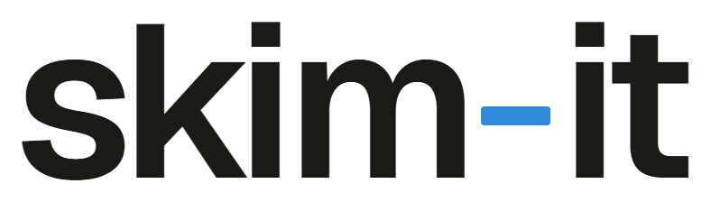
  </picture>
</p>

<p align="center">
  Um Claude Code Desktop mais calmo e fácil de escanear.
  <br>
  Uma linha para cada turno de trabalho, respostas que se leem de relance e uma band que mostra todas as sessões que você roda em paralelo.
</p>

<p align="center">
  <a href="https://github.com/LunkiBR/skim-it/actions/workflows/checks.yml"></a>
  <a href="LICENSE"></a>
  <a href="README.md"></a>
</p>

<p align="center">
  <a href="https://github.com/LunkiBR/skim-it/blob/media/film/skim-it.mp4">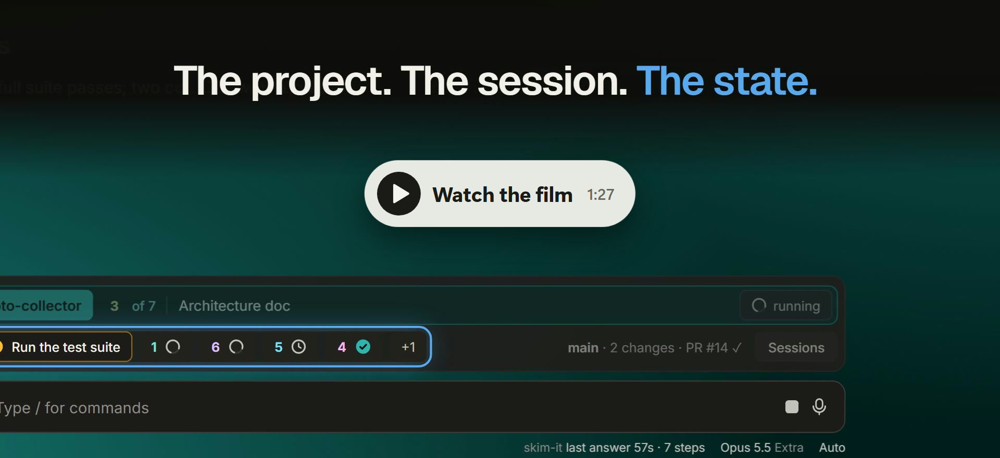</a>
  <br>
  <sub><a href="https://github.com/LunkiBR/skim-it/blob/media/film/skim-it.mp4">Assista ao filme de lançamento</a> · 1:27 · com som, em inglês</sub>
</p>

## Por quê

Rodar cinco ou dez sessões do Claude Code ao mesmo tempo virou normal.
O Desktop mostra cada uma isolada: para saber qual está esperando por você, é preciso abrir uma por uma.
Turnos longos enterram a resposta embaixo de ferramentas e narração.
O skim-it é um mod que resolve as duas coisas sem mudar como o modelo escreve.

## O que muda

O skim-it não é uma barra de status.
Ele muda como o Desktop inteiro se lê, em sete lugares:

1. [Todo o trabalho, numa linha](#todo-o-trabalho-numa-linha)
2. [Respostas que se escaneiam](#respostas-que-se-escaneiam)
3. [Uma band acima do prompt](#uma-band-acima-do-prompt)
4. [A sessão que precisa de você vem primeiro](#a-sessão-que-precisa-de-você-vem-primeiro)
5. [Todas as sessões, por estado](#todas-as-sessões-por-estado)
6. [Cada projeto, a sua cor](#cada-projeto-a-sua-cor)
7. [Um fundo que segue a sessão](#um-fundo-que-segue-a-sessão)

E um cartão guarda todos os ajustes: [`/skim-it`](#um-cartão-para-todos-os-ajustes).

### Todo o trabalho, numa linha

<p align="center">
  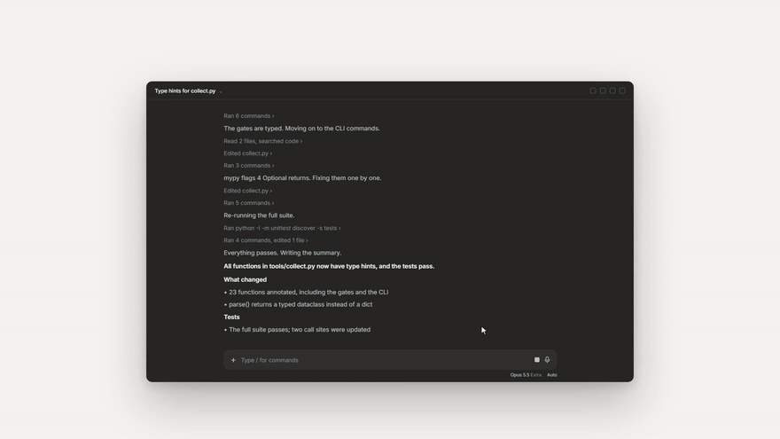
</p>

Quando o turno termina, todo o trabalho (comandos, leituras, narração, falhas) recolhe numa linha: `Trabalhou 7m 57s · 54 passos · 3 arquivos · 1 falha ›`.
A resposta final fica à vista.
Um clique abre a lista, e uma falha nunca some da linha.
Três densidades: compacto (uma linha por turno, o padrão), equilibrado (uma linha por tipo de trabalho) e detalhado (como o app desenha).

<details>
<summary>Antes, e a linha aberta</summary>
<br>
<p align="center">
  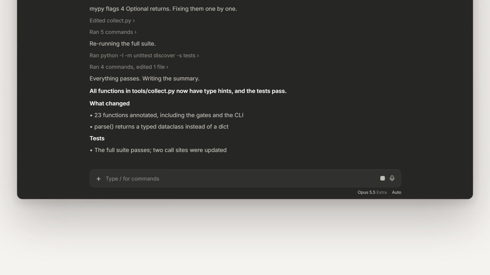
  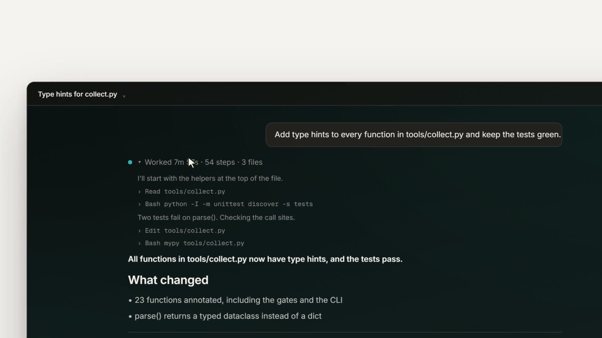
</p>
</details>

### Respostas que se escaneiam

<p align="center">
  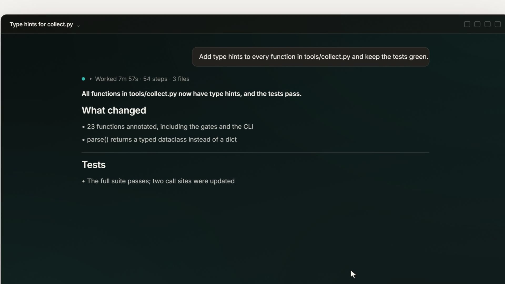
</p>

Títulos um degrau maiores e uma régua entre as seções; tabelas, código e listas ficam como o app desenha.
Links relativos na resposta viram clicáveis.

### Uma band acima do prompt

<p align="center">
  <picture>
    <source media="(prefers-color-scheme: light)" srcset="docs/images/band-light.png">
    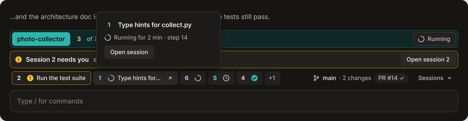
  </picture>
</p>

- **Quem sou eu.** O projeto na cor dele, o número da sessão ("3 de 10") e um assunto automático escrito pelo Haiku.
- **O que estou fazendo.** Um ícone e uma palavra: rodando, precisa de você, em segundo plano, pronta para revisar, sem sinal, parada.
- **O resto da frota.** Todas as outras sessões do projeto por número e estado, as que esperam primeiro.
- **Git.** Branch, alterações e PR com o CI. Um clique abre um painel com os PRs abertos, os arquivos alterados e as branches recentes.

<details>
<summary>Quatro larguras, e os estados</summary>
<br>
<p align="center">
  A band cabe em quatro larguras, de uma janela larga até uma linha só na tela dividida.
  <br><br>
  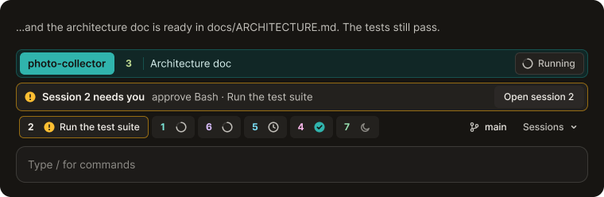
  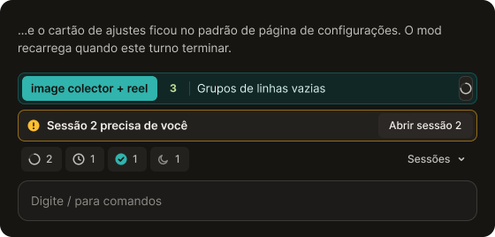
  <br><br>
  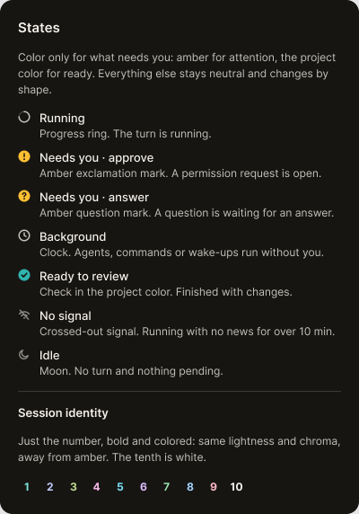
</p>
</details>

### A sessão que precisa de você vem primeiro

<p align="center">
  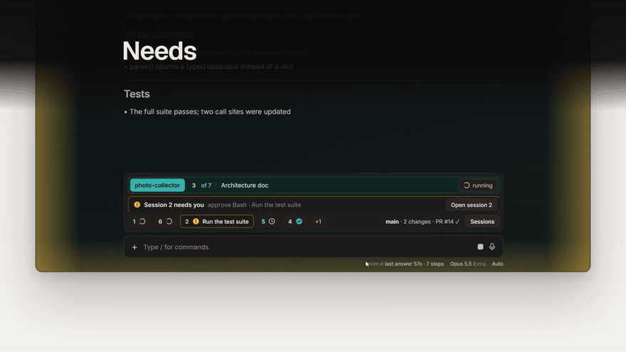
</p>

Quando outra sessão do projeto espera uma aprovação ou uma resposta, uma linha âmbar diz qual e o quê, com um botão que abre a sessão.
O âmbar não é usado para mais nada, então ele sempre quer dizer você.

### Todas as sessões, por estado

<p align="center">
  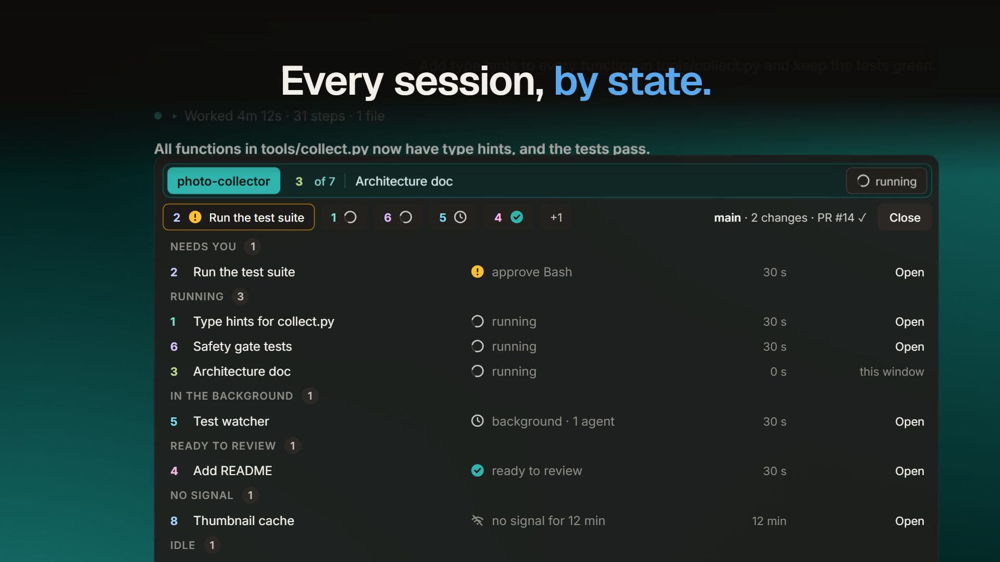
</p>

O painel de sessões lista todas as sessões do projeto agrupadas por estado, com quem espera no topo, sessão mãe e filha, e um arquivamento em lote seguro das paradas há mais de 30 dias.

### Cada projeto, a sua cor

<p align="center">
  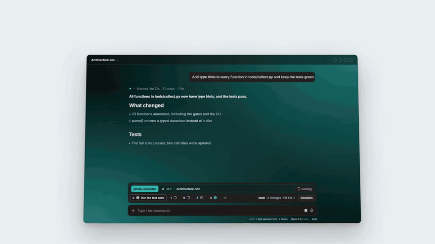
</p>

Um look calmo e de alto contraste: cinzas tingidos, texto principal a 7:1 em toda superfície, cor só onde ela significa algo.
Cada projeto tem a sua cor, do arquivo de marca ou de um hash estável do repositório, e o look segue a sessão onde você digitou por último.
Vermelho, verde e âmbar nunca representam um projeto.

### Um fundo que segue a sessão

<p align="center">
  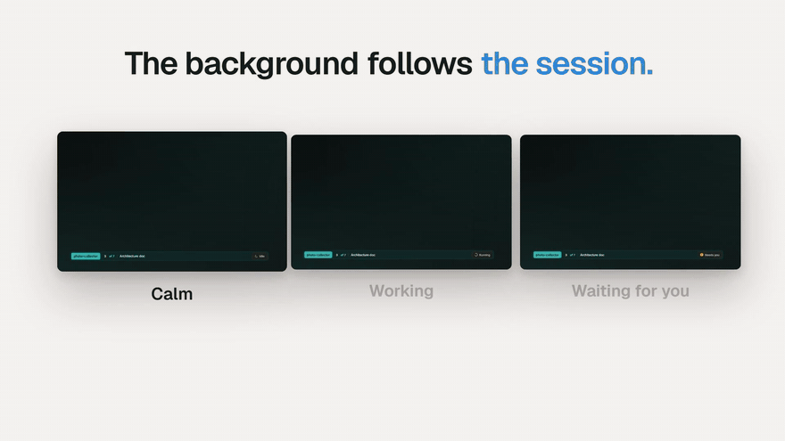
</p>

Atrás do vidro fosco, o fundo diz o estado da sessão de relance: quase cinza em repouso, a cor do projeto respirando devagar enquanto trabalha, e luz âmbar nas bordas enquanto espera você.

### Um cartão para todos os ajustes

<p align="center">
  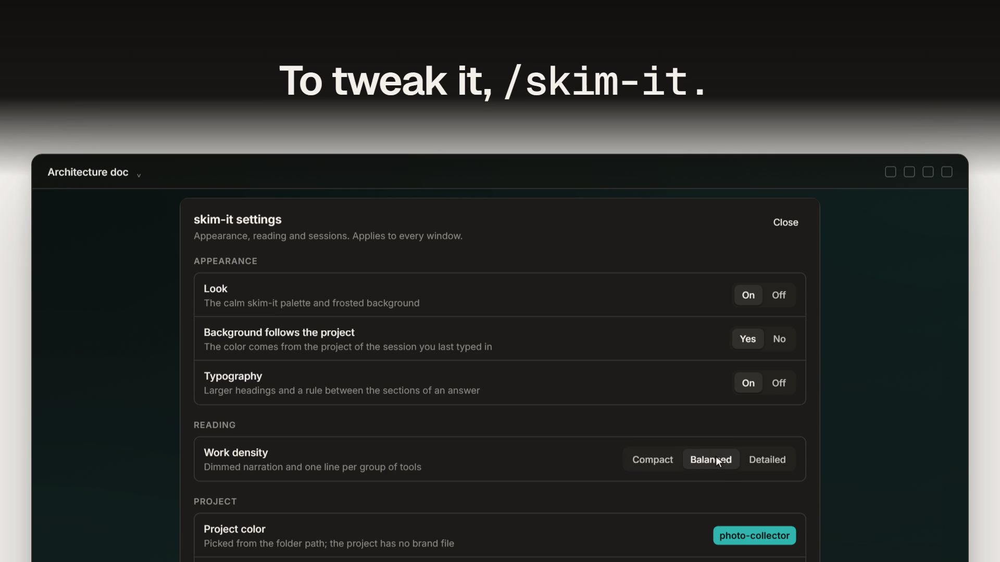
</p>

Digite `/skim-it` e todos os ajustes estão num cartão; cada um também é um [comando](#comandos).

> O filme e estas imagens redesenham o Claude Code Desktop em código com a band, as cores e os fundos do próprio mod, numa frota de demonstração de sete sessões como a que o `/skim-it demo` mostra, em inglês.
> No app o mod desenha o mesmo layout com os componentes do próprio Desktop, então raio e tipografia seguem o seu Desktop.

## Instalação

No prompt de uma sessão do Claude Code:

```
/plugin install skim-it --marketplace LunkiBR/skim-it
```

Responda `y` para adicionar o marketplace e escolha o escopo.
Pelo terminal:

```bash
claude plugin install skim-it --marketplace LunkiBR/skim-it
```

Abra uma sessão nova e digite `/skim-it` para ver os ajustes.

### Requisitos

- Claude Code 2.1.325 ou mais novo, na aba Code do Claude Desktop.
- `git` no PATH para a linha do Git, e o [GitHub CLI](https://cli.github.com) com login para PRs e CI (opcional).
- Feito e usado todo dia no Windows; macOS e Linux devem funcionar, mas ainda não foram testados.

Se outro mod de tema (como o `/custom-theme`) estiver ligado no mesmo projeto, os dois trocam o look a cada mensagem.
Desligue o outro nesse projeto.

## Comandos

Todo ajuste está no cartão que o `/skim-it` abre, e cada um também é um comando.
Os comandos aceitam palavras em português ou inglês (`densidade` ou `density`).

| Comando | O que faz |
|---|---|
| `/skim-it` | Abre o cartão de ajustes |
| `/skim-it tipografia on\|off` | Títulos maiores e régua entre seções |
| `/skim-it densidade compacto\|equilibrado\|detalhado` | Quanto do trabalho do turno fica visível |
| `/skim-it look on\|off` | O look do skim-it no Desktop |
| `/skim-it fundo segue on\|off` | O look segue o projeto da sessão onde você digitou por último |
| `/skim-it painel` | Abre ou fecha o painel de sessões |
| `/skim-it importar` | Propõe um arquivo de marca a partir das cores do projeto; `importar aprovar` grava |
| `/skim-it idioma auto\|pt\|en` | O idioma do mod; `auto` segue o Claude Code |
| `/skim-it demo` | Mostra uma frota de exemplo com sete sessões, para prints e gravações |

## Arquivo de marca

Coloque `.claude/skim-it.json` na raiz de um repositório para dar uma cor a ele:

```json
{
  "tipo": "projeto",
  "marca": { "primaria": "#4b63ce", "secundaria": "#7db2ff" },
  "areas": [{ "caminho": "web/", "intensidade": "vibrante" }]
}
```

| Chave | Significado |
|---|---|
| `tipo` | `projeto` (sessões por um objetivo: band, painel, mãe e filha) ou `espaço` (sessões soltas que só dividem a pasta: só cor e assunto) |
| `marca.primaria` | A cor do projeto; vira o acento e o matiz do look |
| `marca.secundaria`, `marca.neutra` | Cores extras da marca, opcionais |
| `areas` | Caminhos que mudam a intensidade (`vibrante` ou `denso`), nunca o matiz |

O `/skim-it importar` lê a configuração do Tailwind, variáveis CSS, `tokens.json`, `package.json`, `SKILL.md` e `README.md`, propõe o arquivo com a evidência que achou e não grava nada sem a sua aprovação.

## Privacidade e o que ele executa

- **Arquivos de sessão.** Cada sessão grava um JSON pequeno em `~/.claude/skim-it/fleet/` (raiz do projeto, assunto, estado, horários) para as outras a verem. Nada sai da sua máquina.
- **Assunto.** O assunto automático é uma chamada curta ao Haiku por turno, pelo acesso a modelos do próprio Claude Code, com o começo do seu pedido e da resposta.
- **Ferramentas do Desktop.** Títulos, sessão mãe e arquivamento passam pelas ferramentas de sessão do próprio Desktop. No terminal ou por SSH essas chamadas falham em silêncio e a band usa só os arquivos de sessão.
- **Processos.** `git` (status, branch, estatística do diff, branches recentes) e `gh` (lista de PRs e checks), só na pasta da sessão. Abrir outra sessão entrega um link `claude://` ou `https://` ao sistema.
- **Sem rede** própria e sem telemetria.

## Como funciona

O skim-it é um mod do Claude Code: um módulo de hooks em TypeScript que o motor carrega, sem DOM e sem Node.
Ele desenha por hooks de `ui.render`, aplica o look por `$.theme.set` e guarda o trabalho do turno a partir dos eventos `turn.*` e `tool.call`.
O [docs/ARCHITECTURE.md](docs/ARCHITECTURE.md) mapeia os módulos, o [docs/DESIGN-SYSTEM.md](docs/DESIGN-SYSTEM.md) guarda os tokens e as regras das cores e dos ícones, e o [docs/ENGINE-NOTES.md](docs/ENGINE-NOTES.md) lista o que o motor recusa e o que o Desktop desenha de fato.
A pesquisa que embasou estados e cores está em [docs/research/estados-e-cor.md](docs/research/estados-e-cor.md).

## Desenvolvimento

```bash
git clone https://github.com/LunkiBR/skim-it
cd skim-it
claude --plugin-dir .
npm test
```

Antes de um pull request, rode também `claude plugin validate .` e `npm run typecheck` (depois do primeiro carregamento, que grava os tipos em `.claude-plugin/types/`).
O [CONTRIBUTING.md](CONTRIBUTING.md) tem os detalhes.

## Licença

[MIT](LICENSE), exceto `hooks/make-colors.js` e `hooks/make-colors.d.ts`, que vêm do kit de autoria de plugins do Claude Code.

O skim-it é um projeto independente, sem vínculo com a Anthropic e sem endosso dela.
